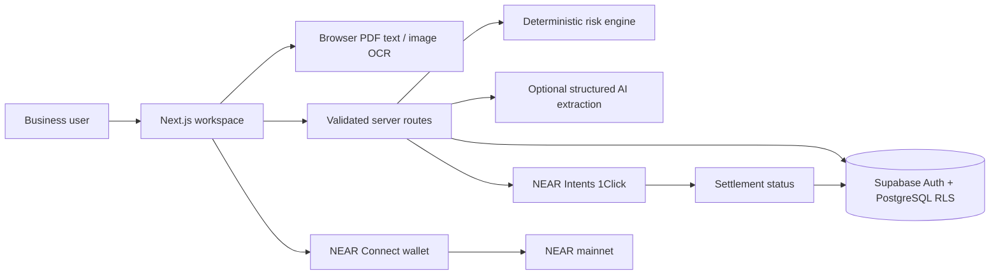
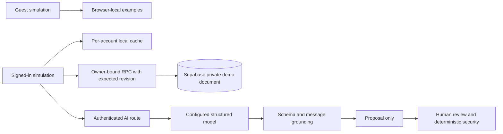
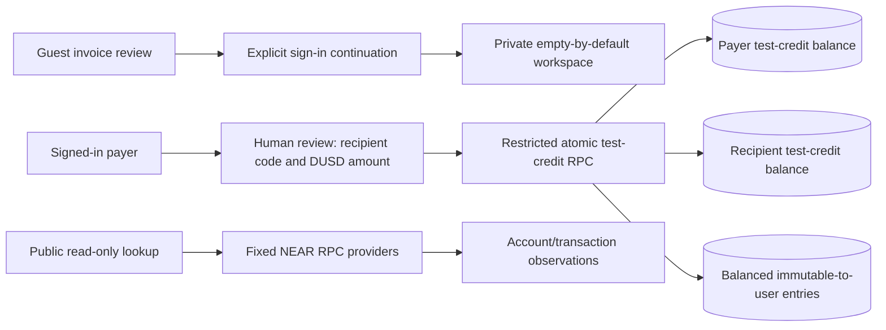

# AFRIPAY AI architecture

Research date: 2026-11-04. Sources are retained in `docs/research`.

Next.js App Router + React + TypeScript + Tailwind. A browser-local, explicitly labeled demo provides a complete invoice-to-simulated-receipt journey. Demo records never enter live transaction tables. Supabase Auth and PostgreSQL provide the production identity and row-level access boundary. No private keys are stored.

## Payment trust boundary
AI prepares proposals only. Risk is evaluated before approval. Critical risk is blocked; high risk requires manual review. Dry quotes use the official API. Mainnet funding is fail-closed in this release: connecting a wallet does not enable payments. A production transaction coordinator with atomic spending reservations, approved quote binding, idempotency, signed quote verification and settlement reconciliation must be enabled before mainnet money moves. Never infer settlement from a wallet submission or a timer. Demo settlement is a separate, explicit action.

The official API endpoints are GET `/v0/tokens`, POST `/v0/quote`, GET `/v0/status`, optional POST `/v0/deposit/submit` on `https://1click.chaindefuser.com`. Dry quotes omit deposit fields. Amounts are integer strings converted using token decimals, never floating-point arithmetic. Slippage is basis points. `SUCCESS` is distinct from `FAILED`, `REFUNDED`, and `INCOMPLETE_DEPOSIT`. Refunds do not mark invoices paid. No Intents testnet exists.

## Evidence and limitations
Risk score is a reproducible capped sum with explicit source labels. Unknown wallet history is not evidence of fraud. NEAR RPC account existence is an observation, not a clean bill of health. No threat-intelligence feed is configured by default. URL analysis is local string analysis and never follows links. QR image decoding and exhaustive redirect analysis are not implemented. OCR output is untrusted and always requires recipient verification.

## Runtime modes
Demo data is local to the browser and may be reset. Authenticated production identity uses Supabase, but live business persistence and funded payment coordination are intentionally not exposed as ready. Public analysis APIs do not accept execution instructions. Per-instance rate limits are suitable for development; use an edge/distributed limiter in production. CSP needs a deployment-specific allowlist for wallet iframe manifests and OCR workers before hardening.

## Hackathon
Deadline 2026-11-14 23:59 UTC. Primary track `realworld`; verify security track ID in retained rules before submitting. Public repository, demo video and founder's X post required. No submission is sent automatically. Exact final submission payload requires the founder's confirmation under official rules.

## 0.2.0 additions

`account_profiles` stores account-owned identity/business fields; signup metadata can prefill customer/supplier preferences but cannot grant admin rights. Guest sample identity is separate from authenticated identity. Profile migrations are independent of existing supplier moderation and mainnet financial tables.

A dedicated NEAR testnet module uses a separate connector/storage namespace, explicit testnet network/feature selection, `.testnet`-only accounts and a 1-test-NEAR cap. The wallet builds exactly one native Transfer; no server or model signs. Read-only testnet RPC routes verify the hash, source, recipient, atomic amount, final execution and recipient receipt. Testnet results do not update demo invoices or mainnet ledgers. Its local history is not a security ledger, and persisted success labels must be rechecked. Mainnet Intents execution remains disabled.

## v0.3 persistence and model boundary

The cloud document contains only simulated invoices, payments, supplier examples, policy, risk reports and editable demo audit entries. The save RPC derives ownership from `auth.uid()` and permits no direct browser writes. Owner-only reads use RLS. Saves use expected revisions to reject stale writes; the client serializes requests and warns on conflicts. Signed-in database operations pin the account's bearer token to prevent an auth switch from applying an old account's queued document under the new account. No guest records are automatically imported into an account.

Model endpoints require Supabase `getUser(token)` verification before paid inference. They pass untrusted text as data, request strict JSON, validate output again server-side and never expose wallet tools. Amounts/assets/recipients absent from a user message are rejected; missing fields remain missing. Invoice model outputs cannot mark verification and an address not present in source text is rejected. Responses identify local parsing versus a configured model.

These controls do not turn client-editable simulation state into a production ledger. Durable mainnet reservations, bound approvals, immutable financial audit records, distributed rate limits and settlement reconciliation remain separate required work.

## v0.4 runtime bootstrap

`/api/config` dynamically validates public Supabase settings on the running server. The browser initializes its shared account client from this no-store response before subscribing to auth state. Account-owned operations continue to pin the current user's token. The public endpoint never returns SMTP/model/partner secrets. Missing setup stays unavailable rather than pretending registration succeeds; local users get CLI repair steps.

Administrator membership is checked for the current account before displaying navigation or mounting the separate console. Supabase's existing restricted admin RPCs remain authoritative. No additional admin privilege or database migration is introduced by the 0.4 UI changes.

## v0.5 account credits and public observations

DUSD uses integer atomic units (100 per credit), zero initial balances and an explicit once-only grant. The security-definer transfer function derives sender from auth.uid(), locks both account rows in a stable order, binds approval ID to recipient/amount, enforces single/daily limits and available funds, updates both balances and inserts transfer/journal rows in one database transaction. No direct user ledger writes are permitted. This is a closed simulation ledger; it does not authorize real funds or settle USDC invoices.

Public NEAR lookups validate network/account/hash, use fixed provider allowlists and receipt-capable EXPERIMENTAL_tx_status, and require matching hash/sender plus complete final receipt success. Existing native testnet verification now uses the same receipt-capable method. Native Transfer action amounts are decoded; contract-token amounts are not inferred. Unknown provider data remains unknown and is never used to update invoice settlement.

Feedback is account-owned under RLS; administrators can read submissions. Insert grants exclude created_at/id so a client cannot backdate feedback to bypass the per-account rate policy. Public contact/credits are the exact founder-approved values. Policy date and publication date are separate; publication remains unset.

## v0.6 shared activity and receipts

One scoped credit-ledger hook supplies Dashboard, Pay, Transfer, Receive and Transactions. It refreshes after mutations/focus and validates its schema/owner. Receive totals exclude faucet grants; activity aggregates all credit transactions and displays the newest 100. Legacy invoice previews are a separately labeled source on the Transactions page, excluded from recorded credit totals.

An additive migration snapshots participant labels, adds purpose/supplier/invoice references and exposes participant-only canonical receipts. A separate PDF generator consumes that canonical DUSD receipt and its fixed recorded timestamp. It never creates a blockchain hash.

Supplier payments hold an approved supplier snapshot and, when linked, the payer's saved invoice/workspace revision. Backend checks derive the recipient from the application owner. Invoice update, debit, credit and journal recording share the database transaction. Idempotent replays return the recorded row before reconsidering later invoice/supplier edits; changed payloads under the same approval ID are rejected.

## Version 0.7 mainnet pilot

`lib/live-payments.ts` validates supported inputs, exact-output units, bound quotes, native funding and settlement evidence. `lib/live-server.ts` verifies Supabase sessions and official 1Click signatures. Fixed URLs only; no arbitrary contract execution. `app/api/live` owns the persisted quote → commit → authorization → funding → observation lifecycle. A server-only Supabase service credential invokes service-only SQL coordinator functions; authenticated browsers can read only their own orders/events. Independent live references never change DUSD documents.

`supabase/live-payments.sql` serializes budget/order changes, claims external steps once, reserves uncertain outcomes, records audit events and restricts receipt eligibility to verified SUCCESS. The browser constructs no free-form wallet actions: it receives exactly one reviewed native Transfer request. Provider-confirmed destination settlement is bound to a final NEAR funding transaction; independent destination-chain decoding is not provided.

## Version 0.8: public invoice binding and private reports

`live-payment-links.sql` extends the existing live coordinator without deleting records. Publication/cancellation require a verified user plus server-only RPCs. Public unguessable tokens expose only intentionally published fields. Policy → request → order row locks serialize reservation/commit with cancellation and prevent another payer from reserving an already-bound request. A server and SQL check bind recipient/chain/asset/amount/reference/text to the published invoice. The public PAID projection requires the bound order's verified SUCCESS, not a caller-supplied paid flag.

The report API verifies Auth, paginates only the user's orders through a creation cutoff, errors on partial/oversized exports and computes exact atomic-unit totals. CSV escapes formula-like cells. Native principal and grouped destination assets are separate; no FX or network fee is invented. Public NEAR data stays distinct from private order assessments. Opening a public link never invokes wallet methods.

## 0.9 saved native testnet invoices

`testnet_invoices` is a separate owner-read/service-write table. `/api/testnet/invoices` verifies the Supabase user and scopes every row read/update to that user. Creation preflights the recipient's testnet account and records the final block floor. Authorization conditionally changes OPEN to AUTHORIZING once, preflights testnet spendable balance and returns one native testnet Transfer. The browser reconstructs that exact transfer and requests wallet approval; the server never signs.

A unique transaction hash attaches once. Verification checks final successful transaction and recipient receipt evidence plus exact source, destination and atomic value, then resolves the execution block by hash and requires its height and timestamp to follow invoice creation. Only then can the service write PAID and its JSON receipt evidence. Unknown/pending stays unpaid. A cancelled/uncertain wallet step stays locked for manual hash recovery. No testnet step writes the DUSD ledger or mainnet payment tables.

## 0.9.2 testnet navigation and public activity

Testnet routes now render distinct overview, invoice, pay, transfer, receive, transaction and analytics views. A remembered address is used only for public lookups; wallet reconnection and explicit approval are still required before signing.

`/api/testnet/activity` requires a verified Supabase session and accepts only named testnet accounts. The POST path retrieves native transfer execution from fixed testnet providers, checks exact signer/hash/actions plus optional reviewed destination/amount, requires FINAL successful receipts, resolves its execution block and validates block hash/height/time. Only those public facts enter service-written `testnet_transfers`, keyed by hash with insert-on-conflict-do-nothing. Pending, failed, unrelated or contract-call execution cannot become a confirmed shared row.

GET reads the latest 100 matching public facts for a wallet, never private invoice rows. No wallet ownership or email identity is inferred from a public address. Totals use integer atomic amounts and cover only the tracked records. Saved invoice payment verification publishes matching public facts after PAID; a failed shared-history write leaves PAID intact and offers hash sync, never automatic resend. Existing paid invoices and browser transfers can be verified/imported without another transfer.

Invoice PDFs and final-payment receipt PDFs are generated locally with embedded bundled fonts. Private invoice descriptions stay in owner-scoped records/PDFs; receiving wallets see public chain payment receipts.

## 0.9.3 wallet-session lifecycle

`WalletSession` owns one lazy NEAR Connector per account/network in the browser tab. `useSyncExternalStore` subscribers can mount/unmount across navigation without disposing that connector. Provider storage and disconnect markers are account/network scoped; public-address caching is not accepted as connection evidence. Restore uses the provider's selected wallet and fresh accounts. Active sessions have no idle-expiry timer. Explicit disconnect/logout clears the displayed address immediately, blocks late sign-in/restore results and waits only a bounded time for provider cleanup. Provider sign-out and actual missing-account results clear the session; transient checks do not silently disconnect it. A changed wallet account invalidates payment review.

Mainnet connection from Pay preserves the payment form. Supported mainnet tools use the existing server-funded pilot and caps; client availability status does not authorize any transaction. Incoming mainnet history projects only the current account's verified paid published requests. No demo records are reclassified as mainnet payments.

## 0.9.4 direct transfers

`live-payment-router.tsx` separates the source network from the destination. `native-mainnet.ts` builds native NEAR reviews and exact Transfer requests, then checks final execution and canonical block freshness. Native orders reuse the existing NEAR policy locks, limits, references and invoice binding, with `execution_kind=NATIVE_NEAR`; they do not request a 1Click swap quote.

`bsc-payments.ts` pins two Binance-Peg token contracts and builds only an exact ERC-20 `transfer`. The EIP-1193 adapter switches and rechecks chain 56 and the account. `bsc-server.ts` performs read-only chain, contract-decimal, token-balance and gas checks; server-only RPCs reserve and claim each order once. BSC observation checks the canonical block, transaction calldata and matching token Transfer log after 12 confirmations. Native and BSC PDFs are available only after verified settlement.

Install the atomic `supabase/mainnet-transfers.sql` after existing payment-link migrations. It adds BSC owner-only tables, route-aware invoice binding/cancellation and native execution metadata, preserving existing records. BSC caps are per token asset; the NEAR policy remains shared by native and Intents orders. BSC history is separate from the NEAR CSV report. These implementations have fixture-based tests; funded mainnet acceptance remains pending.

## 0.9.5 received history and Overview

`/api/mainnet/activity` authenticates the app account, validates the displayed public mainnet address and projects saved verified native transfers across both counterparties. Its whitelist excludes private order IDs, payer user IDs, invoice text/references and risk reports. GET reads facts; POST reconciles at most three already-saved SUBMITTED native hashes with the existing final-execution verifier, then returns the same public projection. No spending, quoting or wallet authorization is available through this route.

The wallet activity list and `live-dashboard.tsx` use exact atomic sums and hash deduplication. The Overview groups native activity by UTC verification day. Only chart coordinates use display-number conversion. Outgoing private orders and published incoming invoice records retain their own permissions; matching native hashes are not repeated as invoice transfers. Either counterparty can download a public native transfer PDF.

`network-suppliers.sql` adds per-owner/per-network mainnet and testnet applications, independent from the legacy table. It copies legacy mainnet registrations with existing review status without promoting invoice contacts or seeded samples. RLS, write guards, immutable networks and stale-snapshot administrator review apply to the new table. Approved directory selection opens an unsigned destination proposal in the selected network; testnet uses the native transfer page. Existing transfer caps, signed quotes and per-payment wallet approval remain in force.
