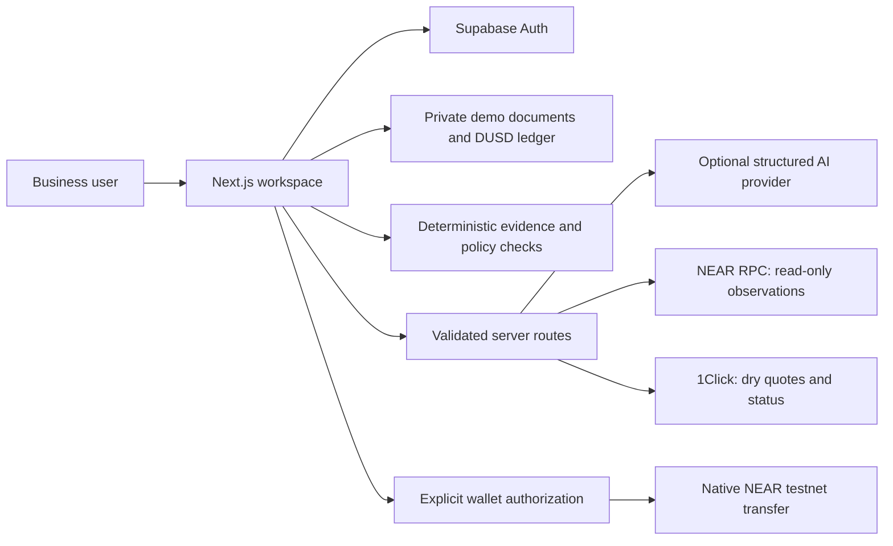
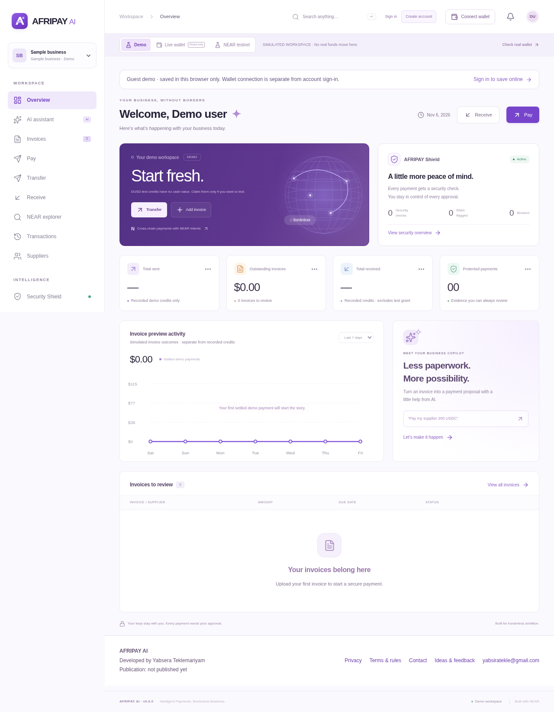
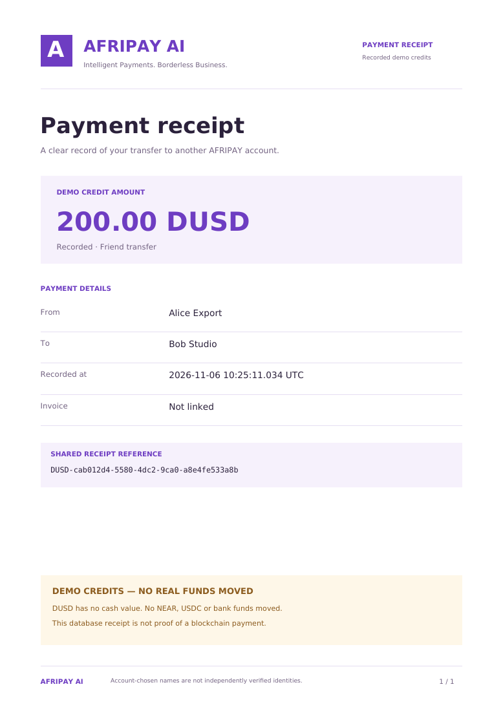

# AFRIPAY AI — detailed project guide

Historical 0.9 guide. For current testnet pages, sent/received activity, PDF receipts and observed signed-payment evidence, see [0.9.2](RELEASE-0.9.2.md).

**Intelligent Payments. Borderless Business.**

AFRIPAY AI helps African businesses review supplier invoices, detect suspicious payment instructions and approve payments with evidence in view. Built for **NEAR HACKATHON 2026**, primarily Real-World Money, with security features relevant to AI Security & Defense.

- **Live prototype:** https://afripay-ai.vercel.app/
- **Public repository:** https://github.com/yabsira13/afripay-ai
- **Version:** 0.9.0
- **Founder and developer:** Yabsera Teklemariyam
- **Contact:** yabsiratekle@gmail.com

**This is a hackathon prototype. DUSD credits remain simulated. Version 0.7 adds an operator-gated native-NEAR-funded Intents pilot, OFF by default. Its application code is tested; a funded end-to-end mainnet transaction has NOT yet been demonstrated.**

## New in 0.9: saved testnet invoice payments and faster startup

[Install 0.9 and run the testnet walkthrough](RELEASE-0.9.md). **NEAR testnet** now includes private saved invoices: create an invoice for a named `.testnet` recipient, review it, approve a native NEAR transfer in your own testnet wallet, then verify its exact transaction and open its explorer link. Only final successful execution with matching sender, recipient, amount, block height and a block timestamp after creation can mark it paid. A transaction hash cannot pay two invoices. A cancelled/uncertain signing request stays locked; recover its existing hash rather than paying again.

**Evidence boundary:** automated tests exercise the application, database authorization and mocked RPC/browser responses. No wallet-signed AFRIPAY testnet invoice payment has yet been demonstrated by the developer in this release. The first actual signed run and its explorer URL remain a required acceptance step. Mainnet Intents settlement is separately unproven end to end. Testnet native transfers do not prove cross-chain execution or gas sponsorship.

Startup now bounds configuration/session/cloud reads, avoids extra auth clients for database calls and offers public NEAR checks while saved data loads. A cloud timeout shows a labeled local fallback; it does not claim cloud saving succeeded. Mainnet/testnet and authentication pages do not wait for simulated workspace storage. Live **Invoices** opens the shareable invoice form. The landing footer now shows the publication date.

### Real, simulated and still to verify

| Capability | Implementation and evidence |
| --- | --- |
| DUSD balances, supplier payments and demo receipts | Simulated credits, no cash value; database/account flows tested |
| Native NEAR balances and account/transaction lookups | Real public RPC reads; unavailable evidence stays unavailable |
| Saved testnet invoice → wallet transfer → explorer/JSON receipt | Implemented with server verification and private database records; actual signed acceptance run still required |
| Mainnet invoice links, funding and settlement monitoring | Implemented operator-gated pilot; no successful funded AFRIPAY end-to-end settlement claimed |
| NEAR Intents discovery and dry quotes | Official API integration and quote-signature validation; dry quotes do not transfer funds |
| CSV export | Live order records with explicit units/status; no invented FX conversions |
| Gas sponsorship / arbitrary source-chain wallets | Not implemented; native NEAR wallet source only |
| Security Shield | Real public observations plus explainable heuristics; no guarantee that a wallet is safe |

Run the additive **`supabase/testnet-invoices.sql`** once after installing 0.9. Keep the server-only `SUPABASE_SERVICE_ROLE_KEY` and existing public Supabase settings. Testnet invoices do not require enabling the mainnet funding flag. Never place server credentials in a `NEXT_PUBLIC_` variable or commit `.env.local`.

## New in 0.8: invoice links, live reporting and evidence

[Install and follow the judge walkthrough](RELEASE-0.8.md). Live **Receive** publishes an immutable invoice request; its public `/pay/<token>` page locks the destination and amount, then continues into the guarded wallet-payment pilot. Opening a link never approves or sends anything. Publication is explicit and must not contain confidential data. The database prevents competing payers from reserving the same request; only verified settlement can mark it PAID.

Live **Transactions** now has authenticated CSV export with explicit units/paid status and origin/destination explorer links. Live **Security Shield** exposes real NEAR observations with plain-English limits and saved order evidence. Live **Analytics** counts verified settlements and groups asset totals without inventing USD valuation. New workspaces remain empty; **Try guided invoice demo** is opt-in.

Install the additive `supabase/live-payment-links.sql` LAST. Existing 0.7 server settings remain necessary. The separate mainnet pilot still requires a human-approved funded end-to-end test; no such successful AFRIPAY swap is claimed here. Native NEAR is the only source-wallet integration and fees are not sponsored.

## What works

| Area | Current behavior |
| --- | --- |
| Invoice intelligence | PDF text extraction, English image OCR, editable fields and explicit recipient verification |
| Security Shield | Explainable risk scores, duplicate checks, changed supplier wallets, suspicious instructions and URL heuristics |
| Pay | Approved-supplier DUSD simulation plus a separate operator-gated native-NEAR-funded pilot |
| Transfer and Receive | Account receive codes, recipient review, atomic debit/credit, named counterparties and received totals |
| Receipts | Sender and receiver see the same reference, amount, recorded names and branded PDF |
| Accounts | Supabase signup, confirmation, sign-in, recovery, private profiles and account-owned demo storage |
| NEAR | Read-only mainnet balance, public wallet/transaction observations and saved native NEAR testnet invoices and a separate quick-transfer lab |
| NEAR Intents | Official token discovery, verified signed quotes and a gated native-NEAR-funded pilot with persistent approval/monitoring |
| Assistant | Structured local payment proposals; optional authenticated model interface; no wallet execution tools |
| Business tools | Shareable invoice checkout, live CSV/reporting, supplier review, restricted admin, policies and private feedback |

New workspaces start empty. Examples load only when selected. Connecting a wallet does not sign you into AFRIPAY or create an email account's wallet.

## Try the hosted demo

Open https://afripay-ai.vercel.app/. Guest invoice/security exploration is available without an account. Approval, private account activity and built-in downloads require sign-in. No wallet or real funds are needed for the DUSD demonstration.

### 1. Extract and review an invoice

1. Choose **Invoices → Upload invoice → Try a clean invoice**.
2. Click **Extract fields** → see 200 USDC and Shenzhen Nova Trading.
3. Review the number, supplier, amount, wallet and chain. Extraction does not approve the recipient.
4. For this labeled sample only, review its sample destination, tick recipient verification and click **Save & run security checks**. For an actual invoice, verify through a known supplier contact first.
5. See the evidence report. Importing the same invoice again demonstrates duplicate detection.

Extraction fills the form; saving advances the workflow. A downloaded payment receipt is not a new supplier invoice.

### 2. Demonstrate invoice fraud protection

After saving the clean sample, choose **Try a suspicious invoice**, extract and review it. The sample establishes a supplier comparison record when loaded. Inspect the changed destination and unsafe instruction evidence. Critical-risk invoice previews are blocked. This is a synthetic scenario, not external intelligence about an actual scammer.

### 3. Transfer credits between two accounts

1. Create and confirm two accounts. Use separate browser profiles or a normal/private window.
2. In each account open **Receive**, set a receipt display name and find its receive code.
3. In account A explicitly claim the once-only **1,000 DUSD** test grant. New accounts otherwise have zero balance.
4. Copy B's code. In A choose **Transfer**, enter the code and **200 DUSD**, review the resolved name and approve.
5. See A's balance become **800 DUSD** and B's become **200 DUSD**, if both started at zero and only A claimed the grant.
6. Open **Transactions** or **Receive** and download the receipt in both accounts → matching reference, participants, amount and date.

Received totals exclude the test grant. Names are chosen by accounts, not verified legal identities. Repeating an approval after a lost response cannot debit twice. Existing accounts retain their previous balances and grant status.

### 4. Pay an approved supplier

1. The supplier registers, applies through **Become a supplier**, and opens **Receive** to activate its credit account.
2. An operator-appointed administrator reviews the application. Ordinary accounts cannot appoint themselves or review suppliers.
3. In the payer account choose **Pay**, select the approved supplier and an amount. Start with **No invoice** for a simple test.
4. Review and explicitly approve → payer debit, supplier credit and a shared receipt.
5. Optionally link a saved verified invoice matching the supplier's business, reviewed wallet, chain and amount. Wait for cloud saving before approval.

The database checks current approval, invoice revision, spending policies, duplicates and available funds. A linked invoice becomes **Paid (demo)** only after the atomic credit operation succeeds. Linked USD/USDC/USDT/DUSD amounts use a one-for-one illustration, not real FX conversion or asset settlement.

### 5. Explore NEAR and invoice previews

- **Live wallet** shows actual native NEAR balance when RPC is available; the separate **Live wallet → Pay** pilot requires operator setup and explicit wallet authorization. Other tokens are not valued in USD.
- **NEAR explorer** reads public wallet state or final transaction execution on the explicitly selected network. Unknown or unavailable data stays unknown.
- **NEAR testnet** is a separate native transfer lab using test tokens, review, user wallet authorization and final RPC checks. It does not settle demo invoices.
- **Open invoice preview** preserves route comparison, risk review and explicit simulated settled/failed/refunded outcomes. These previews do not move DUSD. Their history is labeled separately.
- In the preview, **Live NEAR Intents dry quote** requests real API data when supported. Upstream failures are displayed, never replaced with simulated quotes. No funding or success is implied by a dry quote.

NEAR Intents 1Click is mainnet-only; a native NEAR testnet transfer is not an Intents testnet swap. Version 0.7 implements the separate committed-quote, wallet funding and settlement-check pilot. It remains OFF by default and has not yet completed an actual funded swap.

## Run locally

Install **Node.js 24 LTS**. Clone the repository, open its folder and run:

```sh
npm ci
npm run dev
```

Open the Local URL printed by Next.js, usually http://localhost:3000. Guest exploration needs no credentials. On Windows PowerShell, use `npm.cmd` if script execution policy blocks `npm`.

### Configure accounts

Copy `.env.example` to `.env.local`, or run `npm run setup`. Add your own Supabase public settings:

```env
NEXT_PUBLIC_SUPABASE_URL=https://YOUR-PROJECT.supabase.co
NEXT_PUBLIC_SUPABASE_ANON_KEY=YOUR-SUPABASE-PUBLISHABLE-OR-ANON-KEY
```

Use a publishable or legacy anon key, never a secret/service-role key. `.env.local` is ignored by Git. Restart after changing settings; rebuild if running production locally.

In your Supabase SQL Editor, run these migrations in order:

1. `supabase/account-profiles.sql`
2. `supabase/supplier-marketplace.sql`
3. `supabase/workspace-sync.sql`
4. `supabase/demo-accounts-feedback.sql`
5. `supabase/final-payments.sql` — **LAST**

For the 0.8 live-link pilot also run `supabase/live-payment-links.sql` LAST; it includes the live table/function foundation.

The demo final migration preserves existing balances, grant status and history. Do not rerun only an older ledger migration afterward. `supabase/schema.sql` is an unfinished production foundation, not a substitute for these prototype migrations.

Private demo documents use row-level security and revision checks. They remain user-editable simulations. DUSD balance changes use restricted database functions with atomic journal entries and participant-only receipt access.

### Confirmation and password recovery

Enable email/password authentication and confirmation in Supabase. Set **Site URL** to your actual website origin and allow its `/auth` and `/auth/reset` redirect URLs. For the hosted prototype:

```text
https://afripay-ai.vercel.app/auth
https://afripay-ai.vercel.app/auth/reset
```

For a separate local installation also allow those paths on its exact local origin.

Public registration needs configured custom SMTP; Supabase's default sender has recipient restrictions and low limits. The founder reports successful hosted signup/recovery after configuring Gmail SMTP and branded templates on November 9, 2026. Gmail still has quotas and delivery limitations; this is not a delivery guarantee.

For a small Gmail-based test, configure SMTP in **Supabase**, using `smtp.gmail.com`, port `465`, the full Gmail username and a Google **App Password** generated after enabling 2-Step Verification. Use that same address as the sender. Never use the normal Gmail password. Keep SMTP credentials only in Supabase, never in this repository or frontend environment variables. Templates in `supabase/email-templates/` are installed separately through Supabase; preserve `{{ .ConfirmationURL }}`.

### Optional AI and Intents settings

- `AI_BASE_URL`, `AI_API_KEY`, `AI_MODEL`: trusted OpenAI-compatible structured model provider, server-side only. Model extraction/proposals require verified account sessions and explicit opt-in. Default assistance is labeled local rule-based parsing. Live inference has not been independently verified for this release.
- `ONECLICK_API_TOKEN`: optional server-side 1Click partner token. Provider access depends on the environment. Token discovery returned HTTP 403 in the development environment; no quote or settlement was fabricated.

No seed phrases or private keys are stored. The model cannot sign transactions or authorize payments.

## Deploy and update

The prototype is hosted on Vercel with Supabase. Import the repository, keep Next.js and root directory `./`, and configure the two public Supabase variables above. Install the database migrations and SMTP separately. Update Supabase redirects to your deployed HTTPS origin.

To update an existing deployment, commit the intended files and push to its connected branch; Vercel builds that commit. Check deployment status and verify hosted sign-in, recovery, invoices and two-account activity afterward. Never commit `.env.local`, SMTP credentials or model keys. See [deployment instructions](DEPLOYMENT.md).

## Verification and limitations

Version 0.8 release checks passed:

- **300 automated unit/API/security/embedded PostgreSQL tests**.
- **98 desktop/mobile Chromium browser journeys**.
- TypeScript, optimized production build and **41-route** production startup smoke.
- Downloaded PDF rendering and visual inspection.

Database tests execute actual migrations in embedded PostgreSQL. Account browser tests use the actual SDK against a mock service, not real inboxes. Mobile viewport emulation is not physical Safari or a wallet-app test. Prior read-only API checks observed a real testnet account and an existing public mainnet transaction; AFRIPAY did not initiate that transaction.

Separately, the founder reported successful hosted account, two-account transfer/payment, matching balance/receipt, suspicious-invoice and recovery tests. These are human-reported checks, not automated proof of every production path. The 0.8 code update reran the release checks. Real hosted token discovery and a signature-verified indicative dry quote also succeeded on November 10; neither sent funds. See [verification details](VERIFICATION.md).

Remaining limits:

- The gated mainnet coordinator is implemented but not yet proven with a funded end-to-end swap. Live orders use separate references and public invoice links, and never change DUSD invoice documents. Destination settlement is provider-confirmed, not independently decoded on every destination chain.
- External malicious-address/phishing feeds and full historical flow analysis are not configured. Low heuristic risk is not a safety guarantee; a new wallet alone is not treated as a scam.
- Scanned PDFs without a text layer need image upload or manual entry. English OCR can make mistakes. QR decoding, document signature verification and redirect inspection are not implemented; untrusted URLs are not automatically opened.
- Demo documents/audits are editable, not production financial audit logs. DUSD has no redemption or cash value. No real FX valuation is provided.
- Rate limiting is per-process; a shared/edge limiter and broader operational review are needed for production financial use.
- Gmail and Supabase authentication limits still apply. Hosting does not automatically install SQL, configure SMTP or ensure email delivery.
- No wallet-authorized mainnet transfer, public X demo post or final submission is claimed. A narrated guest website tour exists; the signed-in/funded end-to-end demo still needs recording.

### Reproduce checks

```sh
npm run typecheck
npm test
npm run build
npm run test:smoke
```

Smoke starts a production server itself. For browser checks, run the app in another terminal, install Chromium and run:

```sh
npx playwright install chromium
npm run test:e2e
```

Use `E2E_BASE_URL` for a dedicated test deployment. Browser fixtures mock account/network responses; these are not funded-payment tests.

## Architecture and project files

Next.js App Router, React, TypeScript and Tailwind provide the UI/server routes. Supabase provides Auth and PostgreSQL access controls. Deterministic security rules produce evidence; optional AI summarizes/extracts structured data. NEAR Connect handles explicit wallet connection/authorization; fixed server integrations query RPC and official 1Click APIs.



- `components/`, `hooks/`, `app/globals.css`: workspace, shared ledger screens and responsive design.
- `lib/security.ts`, `lib/invoice.ts`, `lib/assistant.ts`: evidence rules and structured extraction/proposals.
- `app/api/live/` and `lib/live-server.ts`: guarded mainnet coordination and authenticated reporting.
- `app/api/payment-requests/`, `lib/payment-request-server.ts`: explicit public invoices and bound checkout.
- `supabase/live-payment-links.sql`: additive link binding and publication protections.
- `supabase/`: account, supplier, workspace, credit and feedback migrations.
- `tests/`: unit, API, security, database and browser checks.
- `samples/`: invoice examples and a clearly labeled demo credit receipt.

[Architecture](ARCHITECTURE.md) · [Security model](SECURITY.md) · [Version 0.6 guide](RELEASE-0.6.md) · [Checklist](CHECKLIST.md) · [Submission preparation](HACKATHON.md)





## Hackathon disclosure, sources and license

Built from an empty workspace during the November 2026 development window with AI assistance. No pre-existing product or own baseline code was imported. No separate competing project is declared in this workspace. Track choices and final submission remain subject to founder confirmation and current rules.

Uses Next.js, React, Tailwind, Lucide, Supabase JS, NEAR Connect, Tesseract.js, PDF.js, pdf-lib/fontkit, Zod, Vitest, Playwright and PGlite. Exact versions are in `package-lock.json`. Source is MIT licensed; see [LICENSE](../LICENSE). Bundled PDF.js worker and fonts retain their notices/licenses in `public/`.

Official integration research was checked November 4, 2026, with records under `docs/research`. Re-read the live hackathon rules before submitting:

- https://nearhackathon.com/HACKATHON.md
- https://docs.near.org/
- https://docs.near.org/tools/near-connect.md
- https://docs.near-intents.org/integration/distribution-channels/1click-api/quickstart/making-a-request.md
- https://docs.near-intents.org/api-reference/oneclick/request-a-swap-quote.md
- https://docs.near-intents.org/api-reference/oneclick/check-swap-execution-status.md

README updated November 10, 2026. Repository and live deployment are public; no final competition submission has been made by this update.
